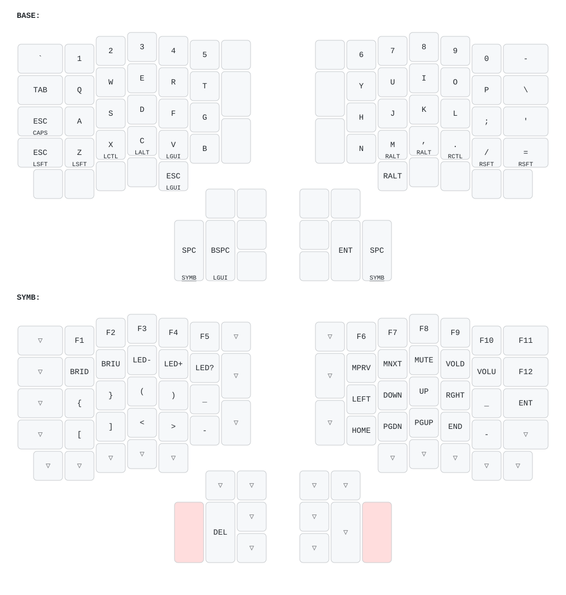
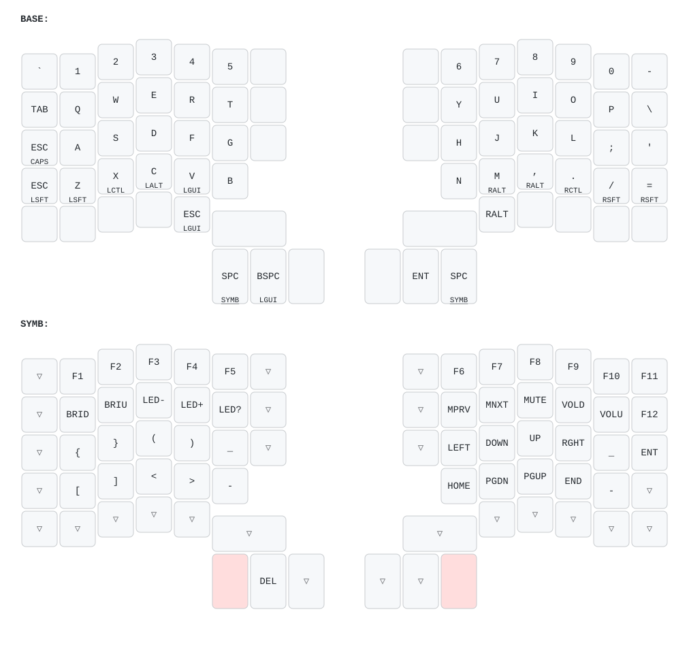
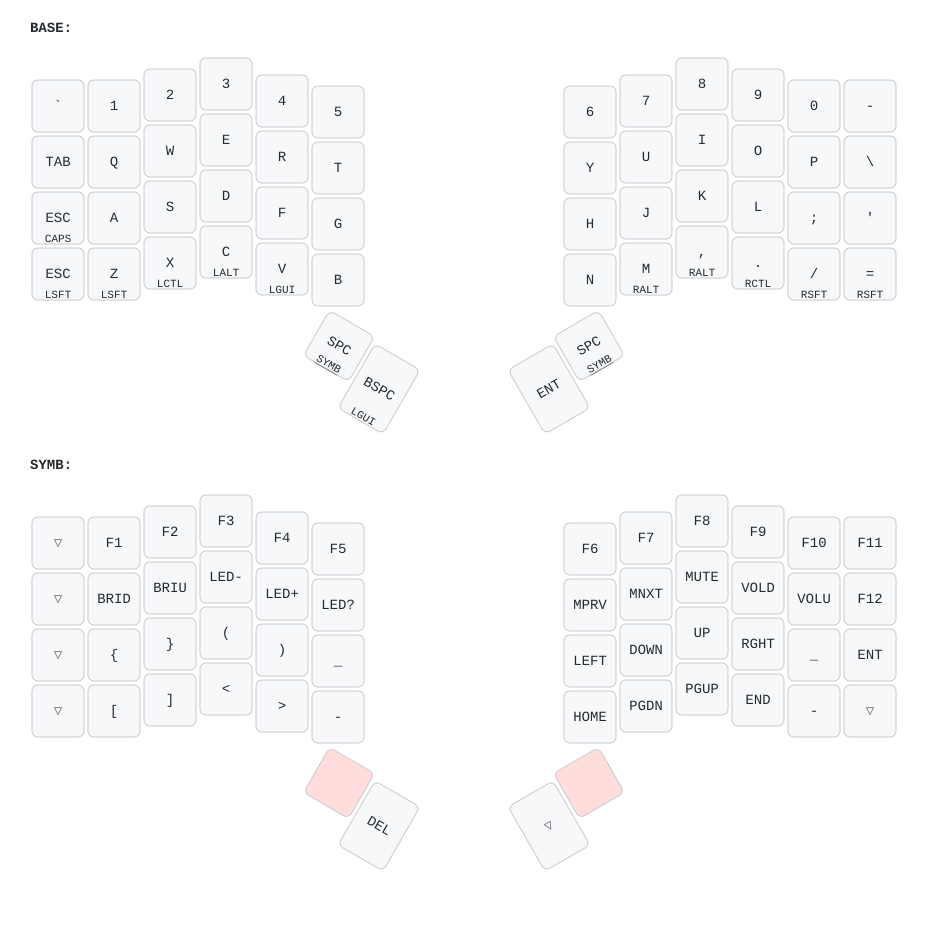

# Keyboard layout

[QMK](https://docs.qmk.fm/) firmware for my ErgoDox EZ (the original model,
without RGB), Moonlander (rev B) and Voyager, all built from one shared layout
in `users/juliusz/layout.h`. Ported from [this Oryx
layout](https://configure.zsa.io/ergodox-ez/layouts/qYArA/vpNNK/0). Built as a
[QMK external userspace](https://docs.qmk.fm/newbs_external_userspace) with
[ZSA's fork of QMK](https://github.com/zsa/qmk_firmware).

Why the fork: Moonlanders sold since December 2025 (rev B) have ZSA's
Ignition bootloader, and only ZSA's fork supports them. Upstream QMK only
builds for rev A, whose firmware a rev B can't run. For a rev A Moonlander,
change `zsa/moonlander/revb` to `zsa/moonlander/reva` in `qmk.json`.

## ErgoDox EZ



## Moonlander



## Voyager



## Commands

The builds run in QMK's Docker image (Docker Desktop needs to be running),
unless a native `qmk` is on `PATH`, in which case that's used.

```sh
make        # build firmware and draw images
make build  # build firmware only, into build/firmware/
make draw   # draw images only, into images/
make flash KB=moonlander  # see Flashing below
make clean  # delete build/ and the qmk_firmware clone
```

The QMK source (ZSA's fork, ~1.3 GB) is cloned to `~/.cache/qmk_firmware`
when needed, at the commit pinned by `QMK_COMMIT` in the `Makefile`, and
deleted by `make clean`. Set `QMK_FIRMWARE` to use a different location.

Drawing uses [keymap-drawer](https://github.com/caksoylar/keymap-drawer),
run with `uvx`.

### Flashing

```sh
make flash KB=moonlander
```

`KB` can be any unique part of a keyboard name in `qmk.json` (`ergodox`,
`moonlander`, `voyager`). It flashes the local build from `build/firmware/` if
there is one (`make clean` removes it). Otherwise it downloads the firmware
from the [latest
release](https://github.com/jgonera/qmk-keymaps/releases/latest), so on
machines where you only flash it needs just this repo, `curl` and
[zapp](https://github.com/zsa/zapp), ZSA's command-line flasher. No QMK or
Docker. It prints which firmware it's flashing. When zapp says it's waiting,
hold SYMB + `FLASH` (top left) for a second, or press the keyboard's reset
button. If you enter the bootloader by accident, unplug and replug the
keyboard: the firmware is still there.

To get zapp, `brew install zapp`. Where you can't install software, download
the macOS binary from [zapp's
releases](https://github.com/zsa/zapp/releases) (it's signed by ZSA, so it
runs without installing) and pass it as `ZAPP=~/Downloads/zapp`.

[Keymapp](https://www.zsa.io/flash) works too: choose the `.bin`/`.hex` file,
click Flash and press the reset button.

### Updating QMK

ZSA makes a new branch of their fork for each firmware version (`firmware25`,
`firmware26`, ...). To update, set `QMK_BRANCH` in the `Makefile` to the
newest [branch](https://github.com/zsa/qmk_firmware/branches) and
`QMK_COMMIT` to its latest commit (`git ls-remote
https://github.com/zsa/qmk_firmware.git <branch>`), then run `make`. To update
the build tools, bump `QMK_IMAGE` in the `Makefile` and the container image in
`.github/workflows/build.yml`. The fork follows upstream QMK, so check the
[QMK changelog](https://docs.qmk.fm/ChangeLog/) for breaking changes.
