# Keyboard layout

[QMK](https://docs.qmk.fm/) firmware for my ErgoDox EZ (the original model,
without RGB), Moonlander (rev B) and Voyager, all built from one shared layout.
This directory is a [QMK external
userspace](https://docs.qmk.fm/newbs_external_userspace), built with [ZSA's
fork of QMK](https://github.com/zsa/qmk_firmware).

Why the fork: Moonlanders sold since December 2025 (rev B) have ZSA's
Ignition bootloader, and only ZSA's fork supports them. Upstream QMK only
builds for rev A, whose firmware a rev B can't run. For a rev A Moonlander,
change `zsa/moonlander/revb` to `zsa/moonlander/reva` in `qmk.json`.

## ErgoDox EZ



## Moonlander



## Voyager


## Files

- `users/juliusz/layout.h`: **the layout**. The layers are written in the shape
  of the ErgoDox EZ, the biggest of the three keyboards. This is the file to
  edit. Keycodes: https://docs.qmk.fm/keycodes
- `users/juliusz/wrappers.h`: maps the ErgoDox-shaped layers onto the
  Moonlander and Voyager. See below for how.
- `users/juliusz/config.h`, `rules.mk`: settings shared by all keyboards.
- `users/juliusz/juliusz.c`: custom key behavior shared by all keyboards
  (e.g. Esc/Caps Lock).
- `keyboards/zsa/*/keymaps/juliusz/`: per-keyboard keymaps. They're mostly
  just `KEYMAPS(...)` with the right wrapper, plus keyboard-specific bits
  (e.g. the ErgoDox's layer LEDs and debounce setting). Each `keymap.json`
  enables ZSA's `zsa/defaults` module, which ZSA's keyboard code needs (it
  defines ZSA's LED keycodes).
- `keymap-drawer.yaml`: settings for the images.
- `images/`: generated by `make draw`. Commit them together with the layout
  change.

### How the layout maps to other keyboards

- **Moonlander**: same main block. The inner column has three 1u keys, so the
  ErgoDox's lower inner key (1.5u) moves up one row. The 3 big thumb keys are
  the ErgoDox's bottom row of the thumb cluster, and the red key gets the
  middle key of the cluster (Play/Pause on the left, Mute on the right). The
  top two keys of each thumb cluster (Prev/Next, Vol-/Vol+) are skipped.
- **Voyager**: only the outer 6 columns of the 4 main rows and the 2 big
  thumb keys on each side. The inner column, the bottom row and the rest of
  the thumb cluster are skipped, so on the base layer the Voyager loses LCtrl,
  LAlt/Esc, LGui/Esc, RAlt, RGui, `[`, `]`, Delete and the media keys, and
  F11/F12 on the SYMB layer.

If a key that only exists on the ErgoDox becomes important, move it to a
position that the smaller keyboards have too, e.g. a free key on the SYMB
layer.

## Commands

The builds run in QMK's Docker image (Docker Desktop needs to be running),
unless a native `qmk` is on `PATH`, in which case that's used.

```sh
make        # build firmware and draw images
make build  # build firmware only, into build/firmware/
make draw   # draw images only, into images/
make flash KB=moonlander  # see Flashing below
make clean  # delete build/ and the qmk_firmware clone
```

The QMK source (ZSA's fork, ~1.3 GB) is cloned to `~/.cache/qmk_firmware`
when needed, at the commit pinned by `QMK_COMMIT` in the `Makefile`, and
deleted by `make clean`. Set `QMK_FIRMWARE` to use a different location.

Drawing uses [keymap-drawer](https://github.com/caksoylar/keymap-drawer),
run with `uvx`.

### Flashing

```sh
make flash KB=moonlander
```

`KB` can be any unique part of a keyboard name in `qmk.json` (`ergodox`,
`moonlander`, `voyager`). It flashes the local build from `build/firmware/` if
there is one (`make clean` removes it). Otherwise it downloads the firmware
from the [latest
release](https://github.com/jgonera/qmk-keymaps/releases/latest), so on
machines where you only flash it needs just this repo, `curl` and
[zapp](https://github.com/zsa/zapp), ZSA's command-line flasher. No QMK or
Docker. It prints which firmware it's flashing. When zapp says it's waiting,
press the keyboard's reset button.

To get zapp, `brew install zapp`. Where you can't install software, download
the macOS binary from [zapp's
releases](https://github.com/zsa/zapp/releases) (it's signed by ZSA, so it
runs without installing) and pass it as `ZAPP=~/Downloads/zapp`.

[Keymapp](https://www.zsa.io/flash) works too: choose the `.bin`/`.hex` file,
click Flash and press the reset button.

### Updating QMK

ZSA makes a new branch of their fork for each firmware version (`firmware25`,
`firmware26`, ...). To update, set `QMK_BRANCH` in the `Makefile` to the
newest [branch](https://github.com/zsa/qmk_firmware/branches) and
`QMK_COMMIT` to its latest commit (`git ls-remote
https://github.com/zsa/qmk_firmware.git <branch>`), then run `make`. To update
the build tools, bump `QMK_IMAGE` in the `Makefile` and the container image in
`.github/workflows/build.yml`. The fork follows upstream QMK, so check the
[QMK changelog](https://docs.qmk.fm/ChangeLog/) for breaking changes.

## GitHub Actions

`.github/workflows/build.yml` runs `make build` and `make draw` on every push
and pull request. The firmware and images are uploaded as artifacts of the run
(`firmware` and `images`), which expire after 90 days. The run fails if the
committed images don't match the layout.

Builds from `main` are also published as
[releases](https://github.com/jgonera/qmk-keymaps/releases) tagged
`<date>-<time>-<commit>`, with the firmware and images attached. They're kept
forever, so any earlier version of the layout can be flashed again.

## Differences from the Oryx version

This layout was ported from Oryx ([original
layout](https://configure.zsa.io/ergodox-ez/layouts/qYArA/vpNNK/0)). Flashing
the firmware from Oryx brings the old setup back. Differences:

- Built from ZSA's fork like Oryx, but without the `zsa/oryx` module, so the
  Oryx-specific features (live training, Keymapp's live layer view) are gone.
- Keycodes were renamed to their current QMK names (e.g. `KC_BSPACE` →
  `KC_BSPC`), and `MT(MOD_LSFT, kc)` was written as `LSFT_T(kc)`.
- `IGNORE_MOD_TAP_INTERRUPT` was dropped: it was removed from QMK, and its
  behavior is now the default.
- Unused keys on the base layer are `XXXXXXX` instead of `_______`. They
  behave the same on the base layer.
